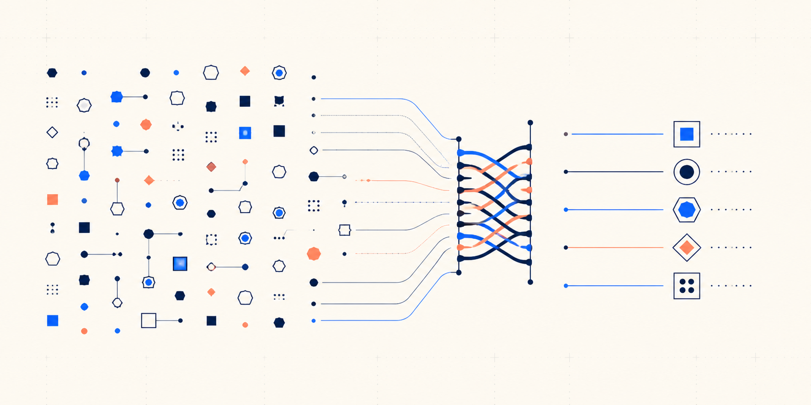

# Skill Loom



<p align="center"><strong>Keep the Catalog private. Keep the runtime small.</strong></p>

<p align="center">
  <a href="ARCHITECTURE.md"><strong>Architecture</strong></a> ·
  <a href="docs/catalog-contract.md"><strong>Catalog contract</strong></a> ·
  <a href="docs/security-model.md"><strong>Security model</strong></a> ·
  <a href="docs/migration.md"><strong>Migration guide</strong></a> ·
  <a href="#quick-start"><strong>Quick start</strong></a>
</p>

<p align="center">
  <a href="https://www.typescriptlang.org/"></a>
  <a href="LICENSE"></a>
  <a href="SUPPORT.md"></a>
  <a href="https://github.com/YunosukeYoshino/skill-loom/actions/workflows/ci.yml"></a>
</p>

---

## What is Skill Loom?

Skill Loom is a **local-first control plane for Agent Skills**. It keeps reusable management code in a public Engine while your authored Skills, Decks, Agent definitions, and Inventory stay in a separate Catalog you control.

The distinction is small but important:

- **Inventory** is everything you track.
- **Projection** is the deliberate subset your agents can see right now.
- **Engine** turns the first into the second without owning your private material.

The result is a reproducible Skill collection without loading the whole collection into every agent session.

## Quick start

```bash
git clone https://github.com/YunosukeYoshino/skill-loom.git
cd skill-loom
bun install --frozen-lockfile
bun install --cwd app/frontend --frozen-lockfile

./skill-loom --catalog-dir examples/catalog status
./skill-loom --catalog-dir examples/catalog list
```

The bundled Catalog is intentionally empty. Copy it into a separate repository when you are ready to add your own Inventory:

```bash
cp -R examples/catalog ../my-skill-catalog
./skill-loom --catalog-dir ../my-skill-catalog status
```

Start the local checklist UI against the same Catalog:

```bash
MY_SKILLS_VITE=1 ./skill-loom --catalog-dir ../my-skill-catalog ui
```

> [!IMPORTANT]
> Skill Loom currently targets macOS. Off transitions use the system Trash so removals stay recoverable. The local UI has no authentication and should remain bound to localhost.

Select a skill name to inspect its files. External skills can be forked, edited manually or with a local Codex App Server, reviewed, and applied as a same-name Vendor while preserving their existing selection and Decks. See [Inspect and fork a skill](docs/skill-workspaces.md) for version tracking, approvals, and recovery.

## Why Skill Loom

- **Private by construction.** The public Engine never needs your real Inventory Lock, authored Skills, Decks, or Agent definitions.
- **A smaller runtime surface.** Active, Archive, and Off states make the agent-visible Projection explicit instead of incidental.
- **One reproducible Inventory.** Inventory Lock v1 records Custom, External, and Vendor sources in a validated file contract.
- **Recoverable operations.** Off transitions use Trash, and Git mutations are scoped to the selected Catalog repository.
- **One model across CLI and UI.** Both interfaces resolve the same Catalog Root and apply the same domain rules.

## Architecture

The Engine resolves your Catalog Inventory into a local Projection: paths are validated, Decks are applied, Off transitions move through the system Trash, and Git writes stay scoped to the selected Catalog repository. The [architecture guide](ARCHITECTURE.md) covers the data flow, the Engine/Catalog ownership table, the entry points, and the project layout.

## Everyday commands

| Command                          | Purpose                                  |
| -------------------------------- | ---------------------------------------- |
| `./skill-loom status`            | Summarize Inventory and Projection state |
| `./skill-loom list`              | List Project Decks                       |
| `./skill-loom install-deck NAME` | Apply a Project Deck                     |
| `./skill-loom all`               | Preview full restoration                 |
| `./skill-loom all --apply`       | Restore the complete Inventory           |
| `./skill-loom ui`                | Open the local checklist UI              |

Management command families expose the same Catalog domain operations to shell workflows:

```bash
./skill-loom external list
./skill-loom external check
./skill-loom external preview owner/repo
./skill-loom external update SKILL --yes

./skill-loom custom check
./skill-loom custom update SKILL --yes

./skill-loom draft list
./skill-loom draft promote SKILL --yes
./skill-loom draft install SKILL --yes

./skill-loom deck show NAME
./skill-loom deck save NAME SKILL... --yes
./skill-loom deck apply NAME --yes
./skill-loom deck merge NAME --yes

./skill-loom skill {active,archive,off} SKILL... --yes

./skill-loom preset list
./skill-loom preset save NAME
./skill-loom preset apply NAME --yes
./skill-loom preset delete NAME
./skill-loom preset restore

./skill-loom link-agents NAME...

./skill-loom plugin export DECK --out DIR [--name NAME] [--version VERSION] [--description TEXT] [--repository OWNER/REPO] [--overwrite]
```

### Project skills

Open **Projects** in the UI to register an existing checkout by absolute path, browse all its skills, install Inventory skills, review updates, or explicitly remove skills. A Project Deck is optional; its bulk sync is a secondary action and does not automatically add Core.

```bash
./skill-loom project add my-app /absolute/path/to/my-app --yes
./skill-loom project list
./skill-loom project status my-app
./skill-loom project install my-app skill-name --yes
./skill-loom project update my-app skill-name --dry-run
./skill-loom project update my-app skill-name --force --yes
./skill-loom project remove my-app skill-name --yes
./skill-loom project remove my-app --yes # unregister only; leave files
./skill-loom project import my-app local-skill --yes # Draft only, no promotion
```

To use a deck, pass its name after the path at registration, then run `project sync NAME --dry-run` or `project sync NAME --yes` (`--force` reviews and overwrites drift). Project copies live in `.agents/skills/`, with relative `.claude/skills/` links and a committed `.agents/skill-loom.json` source-version/content-hash manifest. Codex and Antigravity read `.agents/skills/` directly. The registry stays machine-local in `~/.agents/skill-projects/` (`MY_SKILLS_PROJECTS_DIR` overrides it).

Unmanaged skills are browsable and removable only by explicit per-skill action; bulk sync never touches them. Updating an unmanaged Inventory match adopts it after a diff review; drift also requires review and force. Missing sources are reported as unavailable, and missing checkout paths remain listed. Review and commit the repository diff yourself: Project operations never auto-commit or modify global Active/Archive/locks. See [ADR 0006](docs/adr/0006-project-skills-as-committed-copies.md).

For a project skill without an Inventory match, choose **Import as Draft** (default category `imported`) or run `project import NAME SKILL [CATEGORY] --yes`. This copies it into the Catalog's Drafts without changing the project or auto-promoting; duplicate Inventory/Draft names are rejected. Review and promote through the existing Drafts flow, then use Project update to adopt the copy. Catalog auto-commit settings apply to the imported Draft only, never the Project repository. Reconcile differing project copies or mismatched frontmatter/directory names before importing.

### Plugin export

`plugin export` projects a Project or Shared Deck into an installable plugin
package: an Agent Plugins `plugin.json`, the copied `skills/` tree, and
`.claude-plugin/`, `.cursor-plugin/`, and `.codex-plugin/` manifests. Push the
output directory to a Git repository to install it into Devin, Cursor, Codex,
or Claude Code. Skills a Deck references but the Inventory cannot resolve
abort the export with exit code 2.

`preset` saves and reapplies named subsets of the active global skills. `link-agents`
symlinks an agent's skills directory (`~/.claude/skills`, `~/.gemini/config/skills`)
to `~/.agents/skills`.

State-changing management commands print their targets and require confirmation. Use `--yes`
only in automation that has already reviewed the selected Catalog and target names.

The repository also ships Catalog-aware management Skills for adding, auditing, restoring, and updating External and Vendor Skills.

## Skill Loom vs. ad hoc Skill folders

|                                       | **Skill Loom** | Load everything | Hand-managed folders |
| ------------------------------------- | -------------- | --------------- | -------------------- |
| Private source separated from tooling | **Yes**        | Depends         | Depends              |
| Runtime subset is explicit            | **Yes**        | No              | Manual               |
| Inventory is reproducible             | **Lock v1**    | Partial         | No shared contract   |
| Removal is recoverable                | **Trash**      | n/a             | Depends              |
| CLI and local UI share one model      | **Yes**        | No              | No                   |

Skill Loom adds a small amount of structure in exchange for a clear ownership boundary and a Projection you can reproduce.

## Status

Skill Loom is an initial macOS release. The Engine/Catalog boundary and legacy colocated fallback are stable enough for migration, but cross-platform Trash behavior is intentionally out of scope for this release.

Read the [migration guide](docs/migration.md) before connecting an existing portfolio. For bugs, include the Engine revision, macOS and Bun versions, command, and sanitized output as described in [Support](SUPPORT.md).

## Development

```bash
bun run typecheck   # Typecheck the Engine backend and the Web UI
bun run test        # Run backend and frontend API tests plus the CLI shell test suite
```

## Contributing

Contributions are welcome. Start with [CONTRIBUTING.md](CONTRIBUTING.md), keep tests on the synthetic or temporary Catalog boundary, and report security issues through [SECURITY.md](SECURITY.md).
